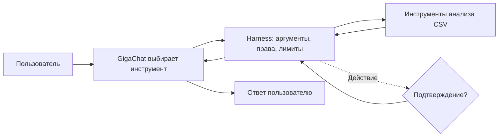

# Bank Statement Agent

Тема проекта: **«Аналитик банковских выписок»**

Агент на **GigaChat** отвечает на вопросы по банковской выписке, самостоятельно выбирает инструменты и возвращает проверяемые результаты. Итоговые суммы считает Python, а не LLM. Для воспроизводимости проект включает небольшую **синтетическую CSV-выписку** без персональных данных.

### Возможности

| Задача | Инструмент | Пример |
|---|---|---|
| Анализ расходов за период и по категории | `get_spending_summary` | «Сколько я потратил в октябре 2026?» → **600 ₽** |
| Подписки и возможные повторные списания | `find_recurring_payments` | «Какие регулярные платежи и дубли есть в выписке?» |
| Пометка подписки по просьбе пользователя | `flag_subscription` | Показывает данные подписки и спрашивает подтверждение |

## Быстрый старт

Требуется Python **3.11+** (проверено локально также на 3.14), сеть и собственные учётные данные GigaChat API.

```bash
python3 -m venv .venv
source .venv/bin/activate
python -m pip install -r requirements.txt
cp .env.example .env
```

В файле `.env` заполни `GIGACHAT_CREDENTIALS` (Authorization Key из Sber Studio). Получение ключа: [документация GigaChat](https://developers.sber.ru/docs/ru/gigachat/quickstart/ind-create-project).

Для работы с доверенным TLS-сертификатом на macOS/Linux:

```bash
bash scripts/setup_certs.sh
```

Скрипт загружает корневой сертификат НУЦ Минцифры из официального источника и проверяет его с помощью OpenSSL. Дополнительные пояснения: [документация GigaChat о сертификатах](https://developers.sber.ru/docs/ru/gigachat/certificates). Проверка сертификата **не отключается**.

Проверь API и запусти **реальную модель**:

```bash
python main.py --check-connection
python main.py --show-tools --message "Сколько я потратил на такси в октябре 2026?"
python main.py  # интерактивный режим
```

В `config.yaml` по умолчанию стоит `GigaChat-2-Pro`. Провайдер и модель задаются конфигурацией (или аргументами `--provider` / `--model`), без изменения логики агента.

## Как устроено



- `llm.py` — адаптер function calling для GigaChat SDK 0.2.4 и тестовый провайдер для offline-проверок.
- `loop.py` — агентный цикл: модель выбирает шаг, код выполняет разрешённый инструмент, результат или ошибка возвращаются модели. Лимит: **6 шагов**.
- `tools.py` — контракты Pydantic, проверки прав, вычисления с `Decimal`, обработка ошибок, таймауты и подтверждение действий.
- `main.py` — консольный интерфейс и безопасные подтверждения.
- `data/sample_statement.csv` — синтетические операции (создаются также командой `python make_statement.py`).
- `logs/trace.jsonl` — локальный журнал фактических вызовов инструментов; исключён из Git.

## Тестирование

```bash
# Быстрые автоматические тесты (без API-ключа)
python -m pytest -q

# Отдельная проверка 4 сценариев на настоящей GigaChat
python scripts/eval_live.py --runs 1

# Для оценки повторяемости: 3 прогона каждого сценария
python scripts/eval_live.py --runs 3
```

Live-проверка контролирует не только текст: она проверяет **имя вызванного инструмента и корректность результата по синтетической выписке**. Трассы остаются в `logs/eval/`.

### Демонстрация отказоустойчивости с настоящей LLM

```bash
python main.py --show-tools --fault-timeout get_spending_summary --message "Сколько я потратил на такси в октябре 2026?"
```

При этом инструмент чтения три раза получит искусственный `timeout`, а **реальная GigaChat** увидит структурированную ошибку и должна сообщить, что сумму подтвердить не удалось, вместо выдумывания числа. В `logs/trace.jsonl` будет `"error": "timeout"`. Для подтверждения изменяющего действия запусти:

```bash
python main.py --show-tools --message "Найди подписку Video Service и пометь её к отмене"
```

Программа покажет данные найденной подписки; ответ `n` отменяет действие, `y` разрешает **только локальную пометку в текущей сессии**.

- [Тест-план и критерии качества](docs/TESTING.md)
- [Полные контракты трёх инструментов](docs/CONTRACTS.md)

## Безопасность и границы работы

Аккаунт выбирает код из сессии, **не модель**. Лишние аргументы запрещены; доступ к посторонней записи в синтетическом CSV ограничен. Изменяющее действие требует подтверждения человеком и не повторяется автоматически. Результаты ограничены 50 элементами, ошибки инструментов структурированы, у цикла есть лимит и защита от зацикливания. Ключи, сертификаты, локальные журналы и реальные выписки не коммитятся.

Здесь реализованы этапы по теме  по теме: читается синтетическая CSV с уже указанными категориями; подписки и дубли выявляются эвристически. Поддержка PDF, автоматическая классификация, аномалии и дашборд относятся к дальнейшей разработке. Агент **не** совершает банковских переводов и **не** отменяет реальные списания.
